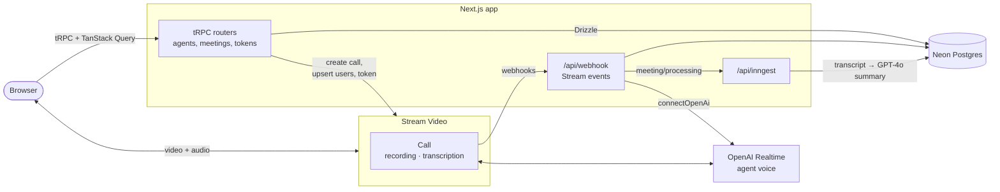

<div align="center">

# AvaMeet

**Run video meetings with an AI agent that joins the call, talks with you, and writes the notes afterwards.**

In AvaMeet you create AI agents with their own name and instructions, then schedule meetings with them. When the call starts, the agent joins as a live voice participant. When it ends, the recording and transcript are processed in the background and turned into a summary with timestamped notes.

[](https://nextjs.org)
[](https://react.dev)
[](https://www.typescriptlang.org)
[](https://trpc.io)
[](https://getstream.io/video/)
[](https://www.inngest.com)
[](https://tailwindcss.com)
[](https://neon.com)

[Features](#features) · [How it works](#how-it-works) · [Tech stack](#tech-stack) · [Getting started](#getting-started) · [Project structure](#project-structure)

</div>

---

## Features

- **Agents with instructions.** Create an agent with a name and instructions, such as "ask these five interview questions" or "track action items". Each one gets a generated avatar (DiceBear) and can be reused across meetings.
- **An AI voice in the call.** When a meeting starts, the agent joins through Stream's OpenAI Realtime integration and speaks and listens according to its instructions.
- **Video calls in the browser.** A lobby with camera and mic preview, then a full call view with speaker layout and controls, built on the [Stream Video](https://getstream.io/video/) React SDK.
- **Recording and transcription by default.** Every call is created with recording (1080p) and transcription switched on, so there's nothing to remember to press.
- **Automatic summaries.** Once the transcript is ready, an [Inngest](https://www.inngest.com) job resolves speaker names and has GPT-4o write an overview plus thematic notes with timestamp ranges.
- **A clear meeting lifecycle.** Meetings move through `upcoming` → `active` → `processing` → `completed` (or `canceled`), and each state has its own detail view. Completed meetings show the summary, duration and recording.
- **A searchable dashboard.** Paginated agent and meeting tables with search, status and agent filters kept in the URL, a collapsible sidebar, and ⌘K search.
- **Sign-in options.** Email and password or Google, handled by [better-auth](https://www.better-auth.com).

## How it works



1. **Creating a meeting** inserts the meeting row, creates a Stream call with recording and transcription set to `auto-on`, and upserts the agent as a Stream user so it can join the call.
2. **Joining a call** asks the server for a short-lived Stream user token (valid for an hour), then opens the lobby and the call.
3. **When the session starts**, Stream sends `call.session_started` to `/api/webhook`. The handler verifies the signature, marks the meeting `active`, and connects the agent to the call with the OpenAI Realtime API, using the agent's instructions as its session prompt.
4. **When the call ends**, the meeting moves to `processing`. The recording and transcript URLs arrive in later webhooks and are saved on the meeting row.
5. **Summarization** runs as an Inngest function in steps: fetch the JSONL transcript, parse it, map speaker ids to user and agent names, summarize with GPT-4o, then save the summary and mark the meeting `completed`. Each step is retried on its own if it fails.

### Webhook events

| Event | What the app does |
| --- | --- |
| `call.session_started` | Marks the meeting `active` and connects the AI agent |
| `call.session_participant_left` | Ends the call |
| `call.session_ended` | Marks the meeting `processing` |
| `call.transcription_ready` | Saves the transcript URL and sends the `meeting/processing` event to Inngest |
| `call.recording_ready` | Saves the recording URL |

## Tech stack

| Layer | Tools |
| --- | --- |
| Framework | [Next.js 15](https://nextjs.org) (App Router), [React 19](https://react.dev), TypeScript |
| API | [tRPC 11](https://trpc.io), [TanStack Query](https://tanstack.com/query), [nuqs](https://nuqs.47ng.com) for URL state |
| Video | [Stream Video](https://getstream.io/video/): React SDK, Node SDK, recording, transcription, webhooks |
| AI | [OpenAI](https://platform.openai.com): Realtime API for the live agent, GPT-4o via [Inngest AgentKit](https://agentkit.inngest.com) for summaries |
| Background jobs | [Inngest](https://www.inngest.com) |
| Data | [Neon](https://neon.com) Postgres, [Drizzle ORM](https://orm.drizzle.team) |
| Auth | [better-auth](https://www.better-auth.com) (email/password and Google) |
| UI | [shadcn/ui](https://ui.shadcn.com) on [Radix UI](https://www.radix-ui.com), Tailwind CSS 4, TanStack Table, [DiceBear](https://www.dicebear.com), react-markdown |
| Forms | React Hook Form, Zod |

## Getting started

### Prerequisites

- Node.js 20 or later
- Accounts on [Neon](https://neon.com), [Stream](https://getstream.io), and [OpenAI](https://platform.openai.com)
- Google OAuth credentials, if you want Google sign-in

### 1. Clone and install

```bash
git clone https://github.com/yusupscopes/AvaMeet.git
cd AvaMeet
npm install
```

### 2. Configure environment variables

```bash
cp .env.example .env
```

| Variable | Where to get it |
| --- | --- |
| `DATABASE_URL` | Neon connection string |
| `BETTER_AUTH_SECRET` | Any random string, e.g. `openssl rand -base64 32` |
| `BETTER_AUTH_URL`, `NEXT_PUBLIC_APP_URL` | Your app URL, `http://localhost:3000` locally |
| `GOOGLE_CLIENT_ID`, `GOOGLE_CLIENT_SECRET` | Google Cloud console, OAuth client |
| `NEXT_PUBLIC_STREAM_VIDEO_API_KEY`, `STREAM_VIDEO_SECRET_KEY` | Stream dashboard, your Video app |
| `OPENAI_API_KEY` | OpenAI dashboard |

The `DB_*` variables are only used by `docker-compose.yml`. The app connects through Neon's HTTP driver (`drizzle-orm/neon-http`), so `DATABASE_URL` should point at a Neon database.

### 3. Set up the database

```bash
npm run db:push
```

This pushes the schema in [`src/database/schema.ts`](src/database/schema.ts) straight to your database.

### 4. Run it

The app, the Inngest dev server and a tunnel for Stream webhooks run as three processes:

```bash
# Terminal 1: the Next.js app on http://localhost:3000
npm run dev

# Terminal 2: the Inngest dev server, for the summary job
npm run dev:inngest

# Terminal 3: a public URL for Stream webhooks (https://avameet.loca.lt)
npm run dev:webhook
```

In the Stream dashboard, set your Video app's webhook URL to `https://<your-tunnel>/api/webhook`. Without it, agents won't join calls and meetings won't move past `active`.

Sign up, create an agent, schedule a meeting with it, and start the call.

## Scripts

| Command | Description |
| --- | --- |
| `npm run dev` | Start the Next.js dev server |
| `npm run build` | Build for production |
| `npm run start` | Serve the production build |
| `npm run lint` | Lint with ESLint |
| `npm run db:push` | Push the Drizzle schema to the database |
| `npm run db:studio` | Open Drizzle Studio |
| `npm run dev:inngest` | Start the Inngest dev server |
| `npm run dev:webhook` | Expose port 3000 through localtunnel for webhooks |

## Project structure

```
AvaMeet/
├── src/
│   ├── app/
│   │   ├── (auth)/            # Sign-in and sign-up pages
│   │   ├── (dashboard)/       # Signed-in app: agents and meetings
│   │   ├── call/[meetingId]/  # Full-screen call page
│   │   └── api/
│   │       ├── auth/          # better-auth handler
│   │       ├── trpc/          # tRPC handler
│   │       ├── webhook/       # Stream Video webhooks
│   │       └── inngest/       # Inngest function endpoint
│   ├── modules/
│   │   ├── agent/             # Agent router, form, table, detail view
│   │   ├── meeting/           # Meeting router, form, table, per-state views
│   │   ├── call/              # Lobby, active call and ended screens
│   │   ├── dashboard/         # Sidebar, navbar, ⌘K command menu
│   │   ├── auth/              # Sign-in and sign-up views
│   │   └── home/              # Dashboard home
│   ├── components/            # Shared UI: data table, states, dialogs, shadcn/ui
│   ├── database/              # Drizzle client and schema
│   ├── inngest/               # Inngest client and the summary function
│   ├── lib/                   # Auth, Stream client, avatars
│   └── trpc/                  # tRPC init, routers, client and server helpers
├── docker-compose.yml
└── drizzle.config.ts
```

## Security notes

- Every agent and meeting procedure goes through `protectedProcedure`, which reads the session from better-auth, and every query is scoped to the signed-in user.
- Webhooks are rejected unless their `x-signature` header verifies against the Stream secret.
- Stream user tokens expire after an hour.
- Input is validated on the server with the same Zod schemas the forms use.

## Acknowledgements

Built with [Next.js](https://nextjs.org), [Stream Video](https://getstream.io/video/), [OpenAI](https://openai.com), [Inngest](https://www.inngest.com), [Neon](https://neon.com), [better-auth](https://www.better-auth.com), [shadcn/ui](https://ui.shadcn.com) and [DiceBear](https://www.dicebear.com).

<div align="center">

Made by [Yusup Maulana](https://github.com/yusupscopes)

</div>
